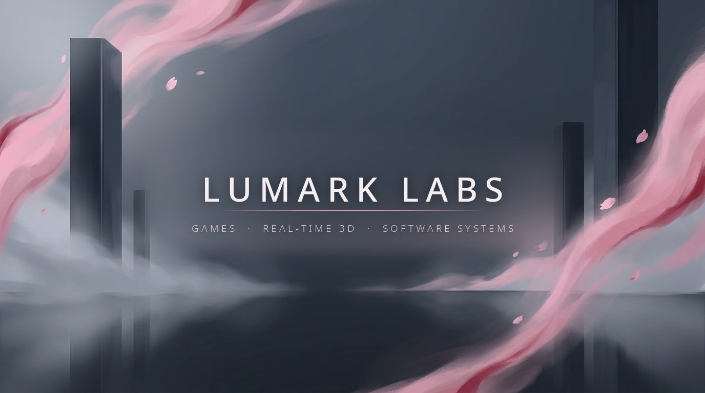

  

<h2 align="center">Lumark Labs</h2>

  <b>Independent Game Studio &amp; Software Engineering House</b> 
  Real-time 3D engines, multiplayer games, interactive B2B installations, mobile &amp; Linux infrastructure

  
  

---

  
  
  
  
  
  
  
  
  
  
  
  
  
  
  

#### Lumark Games
- **Scope:** PC, Mobile &amp; Real-Time 3D Games, multiplayer networking, physics systems &amp; custom shaders
- **In Development:** Unannounced multiplayer title (`Closed-Source` — details kept private)

#### Lumark Software
- **Scope:** Commercial 3D configurators (`WebGL` / `Pixel Streaming`), trade-show &amp; VR installations, enterprise internal systems, mobile/backend platforms &amp; hardened Linux kiosk infrastructure

---

> *Selected shareable B2B, B2C, and infrastructure deliveries. Additional client engagements remain private under NDA.*

| Division | Representative Systems | Stack |
|---|---|---|
| **Interactive Booth &amp; Expo** | `VexelDeck` · `LoomaTap` · `CorvusX` · `Kinetra` · `BrambleTag` · `TesselWall` | Unreal Engine, Unity, C++, C#, Node.js, Linux |
| **3D Configurators &amp; WebGL** | `Plintho` · `SpokeForge` · `StrataLens` · `FoldCraft` · `LumenCast` | Three.js, Babylon.js, Unity WebGL, Pixel Streaming |
| **Enterprise &amp; VR Training** | `VigilRoom` · `TorqueStep` · `BespokeDeck` · `BayGrid` | Unity, Meta Quest SDK, Vue.js, PostgreSQL, Three.js |
| **Brand Gamification** | `BrewDash` · `BinCycle` · `PulseStage` | Unity, WebGL, Android, Socket.io, Node.js |
| **Linux &amp; Kiosk Ops** | `BareBoot` · `SentinelD` · `NodeBeacon` · `CacheHarbor` | Debian/Ubuntu, Systemd, Docker, Nginx, React |

---

  Lumark Labs · Founded by <a href="https://github.com/jarnesence">Járn</a>

