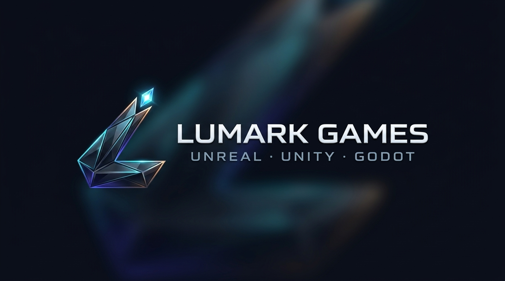

  

<h3 align="center">Lumark Games</h3>

  <b>Independent Game Development Studio</b> 
  Real-time 3D, PC &amp; Mobile Games · Built with <b>Unreal Engine</b>, <b>Unity</b> &amp; <b>Godot</b>

---

### What We Build

- **Engines & Real-Time 3D** — `Unreal Engine` · `Unity` · `Godot` · custom shaders &amp; rendering pipelines
- **Languages & Core Tech** — `C++` · `C#` · `GDScript` · `HLSL / GLSL` · `TypeScript`
- **Platforms & Systems** — Cross-platform mobile (iOS / Android), PC, real-time multiplayer networking &amp; backend services

  Founded by <a href="https://github.com/jarnesence">Járn</a>

